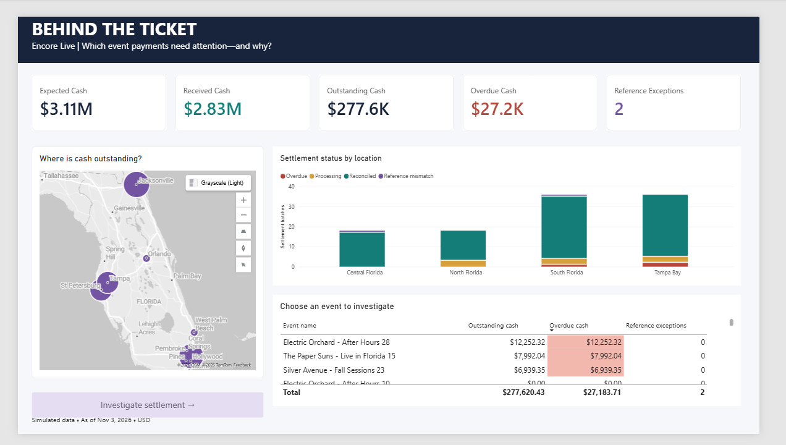
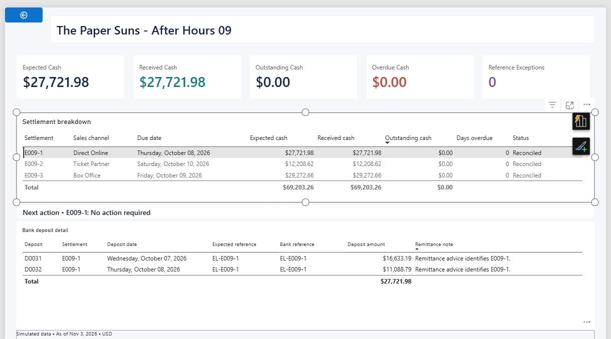

# Behind the Ticket

**Event settlement reconciliation for fictional concert promoter Encore Live.**

A Power BI portfolio project by Alex Stearns that answers: **Which event payments need attention—and why?** It separates overdue cash from payments still processing and bank-reference exceptions where the cash has already arrived.

## Findings at November 3, 2026

- $3,105,051.77 expected; $2,827,431.34 received (91.1%).
- $277,620.43 outstanding, including $27,183.71 overdue.
- Two deposit reference exceptions require reconciliation review, not additional collection of their full amounts.
- Three overdue events account for the overdue balance: Electric Orchard – After Hours 28 ($12,252.32), The Paper Suns – Live in Florida 15 ($7,992.04), and Silver Avenue – Fall Sessions 23 ($6,939.35).

## Explore the report

1. Open [Behind the Ticket.pbix](report/Behind%20the%20Ticket.pbix) in Power BI Desktop.
2. Start at Settlements Overview. Select a location or status to narrow the investigation; hover over an event for its cash bridge.
3. Select an event and use Investigate settlement (Ctrl+click in Desktop edit mode).
4. Select a settlement in the upper table to inspect its deposits and next action. Use the back arrow to return.

The PBIX includes imported data. The [PBIT template](report/Behind%20the%20Ticket.pbit) contains definitions and requires the source workbook to load data.

## Refresh locally

The original files retain the author's local workbook path. Download/extract the whole package, open the PBIX, and use Data source settings to change the Excel source to your local `data/Behind_the_Ticket_Data.xlsx`. Apply changes and refresh. If opening the template prompts for the missing original source, update that source location before loading. All five source queries use the same workbook. Keep worksheet names and columns intact. No credentials are required for the local Excel file.

## Under the hood

- [Model and preparation](docs/Model-and-preparation.md): relationships, query transformations, calculation rules and limits.
- [DAX source](code/Model.dax): measures and calculated objects extracted from the supplied template.
- [Power Query source](code/power-query): six extracted M queries, including the unloaded deposit summary.
- [Data dictionary](docs/Data-dictionary.md): fields/types from the saved model.
- [Validation](docs/Validation.md): independent source totals and manual interaction checks.
- [Source data](data/Behind_the_Ticket_Data.xlsx): simulated workbook, including its original ReadMe.

The central modeling decision is to aggregate split deposits before merging them into settlement rows, preserving the settlement grain. The report then distinguishes collection work from reference correction and provides a specific next action.

## Preview of a split-payment investigation

All data is simulated, all amounts are USD, and expected cash is not profit. Screenshots are development captures; selection handles may appear. The supplied PBIX and PBIT are unchanged originals. Extracted code is for inspection, not a complete PBIP project. No live public report is included.
