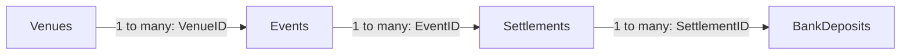

# Model and preparation

## Grain and relationships

Filters flow from venue to event to settlement to deposit. Settings and Cash Bridge Steps are disconnected from that business chain. Power BI also generated local automatic date tables, retained in the delivered files.

## Power Query

Five source queries read workbook sheets, promote headers and assign types. IDs remain text; amounts use fixed decimal currency; dates convert through datetime to date. DepositSummary references BankDeposits and groups receipts by SettlementID before the left merge into Settlements. Missing receipt sums become zero. This retains unpaid settlements and prevents split receipts from multiplying sales rows.

ExpectedSettlement = GrossSales − Refunds − ProcessingFees. OutstandingCash = ExpectedSettlement − ReceivedCash. DaysOverdue applies only to a positive balance with due date earlier than Settings[AsOfDate]. ReferenceMismatchCount compares each associated deposit reference with the expected reference. Status precedence: reference mismatch, overdue, processing, reconciled.

The exported query code retains the original tab-prefixed ReceivedCash intermediate name and its explicit rename. This is harmless in the tested query chain; code is preserved as saved rather than silently refactored.

## DAX and interactions

Model.dax contains the extracted measures, Next Action calculated column and disconnected Cash Bridge Steps table. The bridge measure returns gross sales and negative refunds/fees; the waterfall total represents expected cash. It is not a profit measure.

Overdue Cash preserves existing filters with KEEPFILTERS and returns blank when no settlement rows exist, preventing unrelated event rows from appearing during filtering. Selected Next Action requires a single settlement. The bank-reference color measure compares selected actual/expected references; the deposit table includes ExpectedBankReference to provide that context.

The overview supports Region > City > VenueName exploration, map selection, event sorting, conditional formatting, event tooltip and drillthrough. Investigation supports settlement selection, filtered receipt details and next actions. Selecting a settlement filters KPI cards to that settlement, while the heading identifies its parent event.

## Scope

All records are simulated. BankDeposits[SettlementID] comes from independent remittance advice, so a wrong bank reference does not erase cash received. No unrelated deposits or overpayments are modeled. The snapshot is fixed at November 3, 2026; it is not a daily balance history. Coordinates approximate city centers. Reference Exceptions counts mismatching deposit records. Refresh is manual; no production deployment, scheduled refresh or row-level security is claimed.
